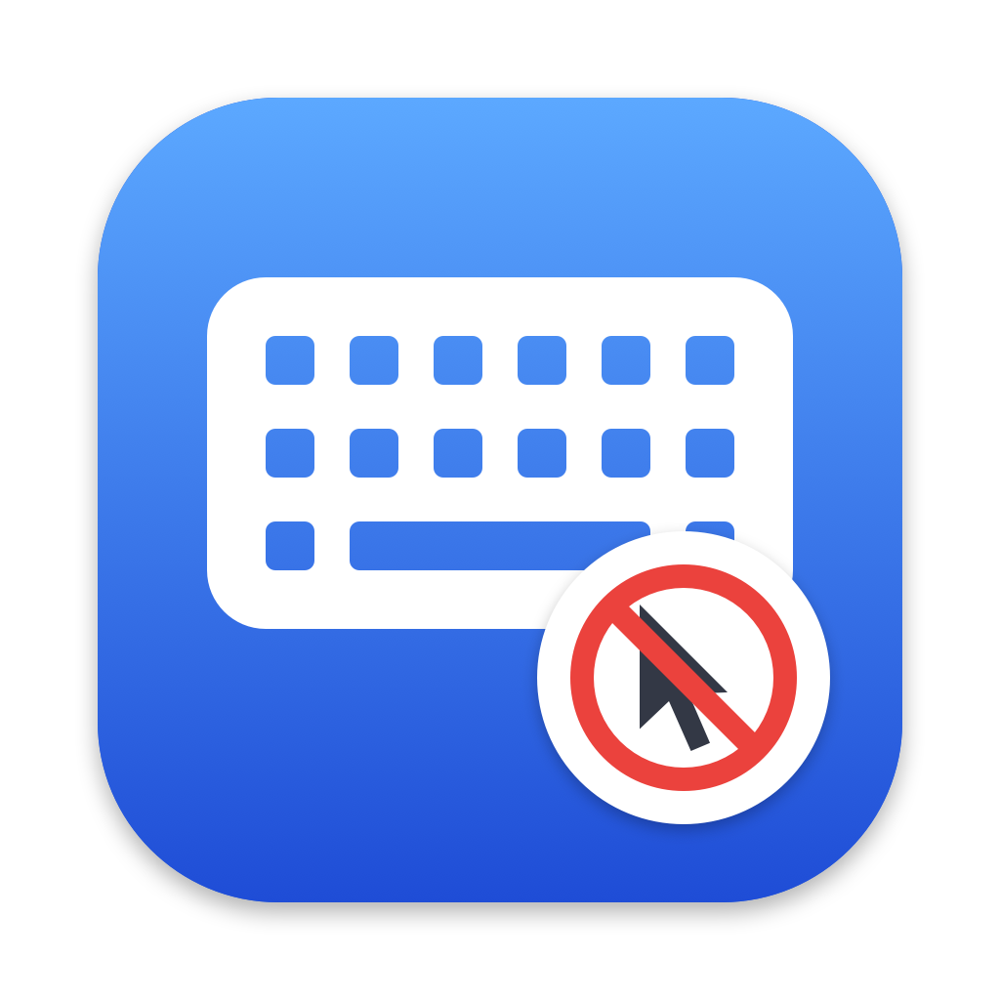
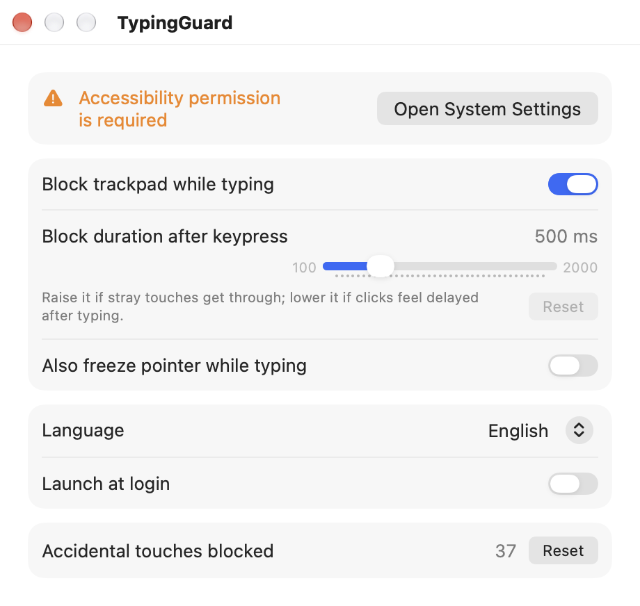

<p align="center"></p>

# TypingGuard

A tiny macOS menu bar app that ignores accidental trackpad input while you type — palm rejection for a Magic Trackpad sitting below a Magic Keyboard.

[中文使用说明](使用说明.md)

After each keypress, clicks, drags and scrolls are ignored for a short window (500 ms by default). Stop typing and the trackpad works again immediately.

<p align="center"></p>

## Features

- Blocks clicks, drags and scrolling while you type; optionally freezes the pointer too
- Adjustable block duration (100–2000 ms, default 500 ms)
- ⌘ and ⌃ shortcuts don't count as typing, so shortcut-then-click keeps working
- Trackpad gestures (three-finger swipes, pinch) are not blocked
- English and Simplified Chinese UI, following the system language by default
- Launch at login
- A single Swift file, no dependencies

## Requirements

- macOS 13 or later
- Xcode Command Line Tools (`xcode-select --install`)

## Build and install

```bash
bash build.sh
```

Move the generated `TypingGuard.app` to `/Applications` and open it. macOS will ask for Accessibility permission: turn TypingGuard on in **System Settings → Privacy & Security → Accessibility**. The menu bar icon stops being dimmed once it is working.

The build is ad-hoc signed, so macOS treats every rebuild as a different app. After rebuilding, remove the old permission and grant it again:

```bash
tccutil reset Accessibility local.typingguard
```

No prebuilt binaries are provided. The app is not notarized by Apple; build it from source.

## Privacy

TypingGuard needs Accessibility permission because it installs a system-wide event tap that sees key-down and pointer events. It uses key events only to record *when* the last key was pressed. It does not read, store or transmit which keys you press, and it makes no network connections. The only data it saves are your settings and the blocked-touch counter, in local user defaults.

## Disclaimer

This software is provided "AS IS", without warranties or conditions of any kind, either express or implied, and the authors are not liable for any damages arising from its use. See sections 7 and 8 of the [Apache License 2.0](LICENSE) for the full terms.

In particular:

- TypingGuard intercepts and discards input events system-wide. A bug, or a setting that does not suit you, can make clicks or scrolling appear unresponsive. Use it at your own risk. If input ever gets stuck, quit TypingGuard from the menu bar, or run `pkill TypingGuard` in Terminal.
- It is tested only on the author's own hardware and macOS version. Behaviour on other devices, input methods or macOS versions is not guaranteed.
- It is not suitable for situations where missed or delayed pointer input could cause harm or loss.

TypingGuard is an independent project. It is not affiliated with, endorsed by or sponsored by Apple Inc. Mac, macOS, Magic Keyboard and Magic Trackpad are trademarks of Apple Inc.

## License

Copyright 2026 The TypingGuard Authors

Licensed under the [Apache License, Version 2.0](LICENSE).
